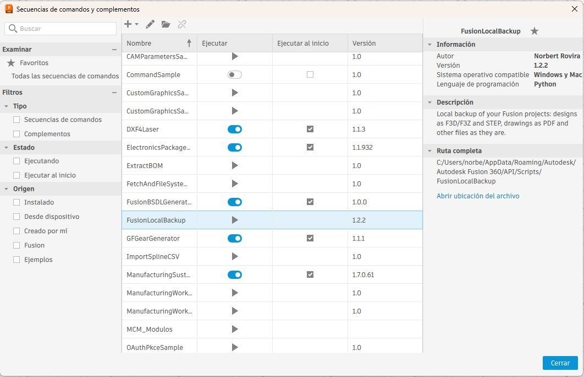
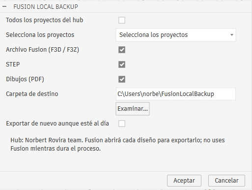
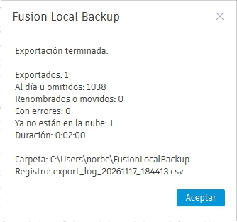

# Guía de uso de Fusion Local Backup

*[Read in English](guide.md)*

Esta guía explica cómo instalar el script, hacer la primera copia y mantenerla al día.

## Antes de empezar

- Necesitas Autodesk Fusion instalado y con tu sesión iniciada.
- El script funciona en Windows y en Mac.
- La copia ocupa espacio en disco. Cada diseño se puede guardar en dos formatos, archivo de Fusion y STEP; en el diálogo eliges si quieres los dos o solo uno. Con los dos ocupa más.
- La primera copia de un proyecto grande es larga. Elige un momento en el que no necesites Fusion.

## Instalación

**Descarga [FusionLocalBackup.zip](https://github.com/norbertut/fusion-local-backup/releases/latest/download/FusionLocalBackup.zip)** (última versión) y descomprímelo. Dentro hay una carpeta `FusionLocalBackup` con dos ficheros, `FusionLocalBackup.py` y `FusionLocalBackup.manifest`. **Esa carpeta, y solo esa, es la que se instala.**

> Si descargas desde la página de la release, elige **FusionLocalBackup.zip**, no "Source code". Si tienes una carpeta llamada `fusion-local-backup-main`, es el código completo del repositorio: no la instales entera, usa la carpeta `FusionLocalBackup` que hay dentro.

Una vez instalado, debe quedar así, con los dos ficheros directamente dentro de `FusionLocalBackup`:

```
Scripts/
└── FusionLocalBackup/
    ├── FusionLocalBackup.py
    └── FusionLocalBackup.manifest
```

Hay dos formas de instalarlo. Elige la que prefieras.

### Opción A: en la carpeta de scripts de Fusion

Fusion reconoce directamente lo que hay en su carpeta de scripts.

1. Copia la carpeta `FusionLocalBackup` en la carpeta de scripts de Fusion:
   - Windows: `%appdata%\Autodesk\Autodesk Fusion 360\API\Scripts`. Puedes pegar esa ruta tal cual en la barra de direcciones del Explorador de archivos.
   - Mac: `~/Library/Application Support/Autodesk/Autodesk Fusion 360/API/Scripts`. En Finder, usa **Ir > Ir a la carpeta** y pega la ruta.
2. En Fusion, abre **UTILIDADES > Complementos > Secuencias de comandos y complementos** (atajo: `Mayús + S`). El script ya aparece en la lista; si no, reinicia Fusion.

### Opción B: en la carpeta que tú quieras

1. Deja la carpeta `FusionLocalBackup` en un sitio definitivo. Fusion no la copia, la usa desde donde esté, así que si después la mueves o la borras el script dejará de funcionar.
2. En Fusion, abre **UTILIDADES > Complementos > Secuencias de comandos y complementos** (atajo: `Mayús + S`).
3. Pulsa el botón **+**, arriba a la izquierda de la lista, y elige la opción de añadir desde el dispositivo.
4. Selecciona la carpeta `FusionLocalBackup`.

Con cualquiera de las dos, el script aparece en la lista como **FusionLocalBackup**. Solo hay que instalarlo una vez.



Para actualizarlo más adelante, descarga la versión nueva y sustituye los ficheros de la carpeta donde lo instalaste.

## Tu primera copia

1. En la ventana de Secuencias de comandos y complementos, busca **FusionLocalBackup** y pulsa el icono ▶ de la columna **Ejecutar**.
2. Se abre el diálogo del script, con estas opciones:



| Opción | Para qué sirve |
|---|---|
| **Todos los proyectos del hub** | Copia todos los proyectos del hub que tengas activo. |
| **Selecciona los proyectos** | Lista de proyectos con casillas. Marca solo los que quieres copiar. Se oculta si marcas la opción anterior. |
| **Archivo Fusion (F3D / F3Z)** | Guarda cada diseño en el formato propio de Fusion, que conserva el historial y se puede volver a abrir y editar. |
| **STEP** | Guarda además una copia en STEP, un formato neutro que abre cualquier programa de CAD. |
| **Dibujos (PDF)** | Exporta cada dibujo 2D a un PDF con todas sus hojas. Viene desmarcada. Abrir cada dibujo lleva unos segundos, así que alarga la copia si tienes muchos. |
| **Carpeta de destino** | Dónde se guarda la copia. Usa **Examinar...** para elegirla. |
| **Exportar de nuevo aunque esté al día** | Vuelve a exportar todo lo seleccionado, haya cambiado o no. Normalmente va desmarcada. |

3. Pulsa **Aceptar**.

Un consejo para empezar: prueba primero con un proyecto pequeño, para ver cómo funciona y cuánto tarda en tu equipo.

## Qué ocurre mientras trabaja

1. **Rastreo.** El script recorre los proyectos elegidos y muestra cuántos ficheros lleva encontrados.
2. **Exportación.** Abre cada diseño, lo exporta y lo cierra. La barra indica por cuál va.
3. **Espera final.** Si hay ensamblajes, al terminar espera a que lleguen los últimos F3Z.

Mientras tanto no uses Fusion: verás cómo se abren y cierran diseños solos.

Puedes pulsar **Cancelar** en cualquier momento. El script termina el diseño que tiene abierto y se detiene. Lo ya exportado queda anotado, así que la siguiente ejecución continúa desde ahí.

Al acabar aparece un resumen:



## Qué encontrarás en la carpeta de destino

La copia reproduce la estructura que tienes en Fusion:

```
FusionLocalBackup/
├── fusion-local-backup.json
├── export_log_20261115_195916.csv
└── Nombre del hub/
    └── Nombre del proyecto/
        ├── Pieza.f3d
        ├── Pieza.step
        ├── Logo.svg
        └── Subcarpeta/
            ├── Ensamblaje.f3z
            └── Ensamblaje.step
```

- **Los diseños**, cada uno en su carpeta, con el mismo nombre que en Fusion.
- **Los demás ficheros del proyecto** (imágenes, SVG, DXF, PDF...), copiados tal cual junto a los diseños.
- **`fusion-local-backup.json`**: el índice. Anota qué versión de cada diseño está copiada. No lo borres ni lo edites: sin él, el script no sabe qué tienes ya y lo exporta todo de nuevo.
- **`export_log_FECHA.csv`**: el registro de cada ejecución. Se abre con Excel o cualquier hoja de cálculo.

### F3D o F3Z

- Un diseño sin vínculos a otros se guarda como **F3D**.
- Un diseño que enlaza otros diseños (un ensamblaje con piezas vinculadas) se guarda como **F3Z**, que lleva dentro el ensamblaje y todas sus piezas.

Por eso, en un proyecto con ensamblajes, cada pieza aparece dos veces: suelta como F3D y dentro del F3Z del ensamblaje. Es lo esperado.

### El registro

Cada línea del CSV es un fichero, con uno de estos estados:

| Estado | Significado |
|---|---|
| **ok** | Copiado. En un diseño, el detalle indica los formatos y la versión, por ejemplo `F3D, STEP (v7)`. En cualquier otro fichero, `Fichero copiado tal cual (v1)`. |
| **omitido** | No se ha copiado: ya estaba al día, es un dibujo y la opción "Dibujos (PDF)" está desmarcada, o es un tipo de fichero de Fusion que aún no se copia (plantillas de dibujo, electrónica). |
| **error** | Ha fallado. El detalle explica qué formato y por qué. |
| **no está en la nube** | El diseño estaba copiado pero ya no existe en Fusion. La copia local se conserva. |
| **aviso** | Información que no corresponde a un diseño exportado. Dos casos: la ejecución anterior no llegó a terminar (indica en qué diseño se interrumpió), y, en Windows, una lectura de la memoria e identificadores que usa Fusion, cada 100 diseños abiertos. |

El registro se escribe línea a línea mientras avanza la copia, así que se conserva aunque Fusion se cierre a medias. La última línea indica la duración total.

Si un ensamblaje usa una versión antigua de una pieza enlazada, el detalle lo avisa: `Usa referencias desactualizadas: Pieza v3 -> v12`. La copia es correcta; solo te informa de que ese ensamblaje está pendiente de actualizar en Fusion.

## Mantener la copia al día

Vuelve a ejecutar el script cuando quieras, **con la misma carpeta de destino**. El diálogo recuerda la carpeta y los proyectos que marcaste, así que basta con abrirlo y pulsar Aceptar.

En cada ejecución, el script compara la versión de cada diseño en la nube con la que tiene anotada y solo exporta:

- los diseños nuevos,
- los que has modificado y guardado desde la última copia,
- los que falten en el disco.

En disco se conserva siempre la última versión de cada diseño; las anteriores se sustituyen.

Además:

- Si **renombras o mueves** un diseño en Fusion, sus ficheros locales se mueven al sitio nuevo.
- Si **borras** un diseño en Fusion, su copia local no se borra; el registro te avisa.

## Preguntas frecuentes

**¿Por qué recibo correos de Autodesk?**
Cada F3Z lo empaqueta Autodesk en la nube, y su servicio envía un correo "is ready to be downloaded" por cada uno. No tienes que hacer nada con ellos: el fichero ya está en tu carpeta. Si tienes muchos ensamblajes, crea un filtro en tu correo para esos mensajes.

**¿Por qué tarda tanto la primera vez?**
Porque hay que abrir cada diseño una vez, y cada uno lleva varios segundos. Las copias siguientes solo abren lo que ha cambiado y son mucho más rápidas.

**¿Puedo seguir trabajando en Fusion mientras copia?**
No. El script usa Fusion para abrir y exportar cada diseño.

**¿Modifica mis diseños?**
No. Los abre, los exporta y los cierra sin guardar.

**¿Guarda el historial de versiones?**
No. Guarda la última versión de cada diseño.

**¿Copia las imágenes, SVG, DXF o PDF que tengo en el proyecto?**
Sí. Cualquier fichero que no sea propio de Fusion se copia tal cual, en la misma carpeta que tiene en el proyecto y con el mismo control de versiones: solo se vuelve a descargar si subes una versión nueva. Un STEP subido a mano también se copia así.

**¿Copia los dibujos (planos)?**
Sí, si marcas "Dibujos (PDF)". Cada dibujo se guarda como un PDF con todas sus hojas, junto a los diseños. No se guarda el dibujo editable de Fusion, porque Fusion no permite exportarlo. Si el dibujo no está actualizado respecto a su diseño, el registro lo avisa.

**Tengo la licencia personal de Fusion. ¿Puedo copiar los dibujos?**
Sí. Se ha probado con la licencia personal y los dibujos se exportan a PDF igual que con una licencia completa. Autodesk podría cambiarlo en una actualización; si algún día Fusion rechaza los dibujos, el script deja de intentarlo tras los dos primeros y el resto de la copia sigue con normalidad.

**¿Copia la electrónica?**
Todavía no. Queda anotada en el registro como omitida, igual que las plantillas de dibujo.

**¿Qué pasa si elijo otra carpeta de destino?**
Se hace una copia completa nueva en esa carpeta, con su propio índice.

**Tengo varios hubs. ¿Cómo los copio?**
El script trabaja con el hub activo. Cambia de hub en el panel de datos de Fusion y vuelve a ejecutarlo.

**He modificado una pieza, pero el F3Z del ensamblaje no se ha vuelto a exportar.**
Es correcto. El F3Z guarda el ensamblaje tal como está guardado, con la versión de cada pieza que tiene fijada. Se volverá a exportar cuando abras el ensamblaje, aceptes la actualización y lo guardes. La pieza modificada sí se copia por su lado.

**Aparece el aviso "Componentes externos sin resolver".**
Es un aviso de Fusion, no del script. Sale al abrir un ensamblaje que enlaza a un componente que Fusion ya no encuentra. No detiene la copia y no hace falta cerrarlo. Ese ensamblaje se guarda sin el componente que falta.

## Si algo falla

- **Un diseño da error.** Mira la columna de detalle del registro. El resto de diseños se exportan igualmente, y el que falló se reintenta en la siguiente ejecución.
- **Un diseño avisa de "componentes externos sin resolver".** Enlaza a un componente que ya no existe o está archivado. Se guarda como F3D sin ese componente y el registro lo indica. Para arreglarlo, abre el diseño en Fusion y suprime o reemplaza el componente roto.
- **Un F3Z no llega.** Si Autodesk no lo entrega en diez minutos, se anota como error y el script continúa. La causa más habitual es un ensamblaje con referencias desactualizadas: ábrelo en Fusion, actualiza las referencias (el aviso aparece al abrirlo), guárdalo y vuelve a lanzar la copia. Si no es eso, vuelve a ejecutarlo más tarde.
- **Fusion se cierra durante una copia larga.** Puede ocurrir en copias de cientos de diseños seguidos: Fusion no libera toda la memoria de los documentos que abre y cierra. Vuelve a abrir Fusion y lanza la copia otra vez con la misma carpeta de destino: continúa donde se quedó y no repite lo ya copiado. El registro de la nueva ejecución empieza con un aviso que indica en qué diseño se interrumpió la anterior. Si se cierra siempre en el mismo diseño, ábrelo a mano en Fusion para comprobar si está dañado.
- **El script no aparece en la lista de Secuencias de comandos y complementos.** Casi siempre es que se ha copiado la carpeta equivocada. `FusionLocalBackup.py` tiene que estar directamente dentro de la carpeta `FusionLocalBackup`, no en una subcarpeta como `fusion-local-backup-main/FusionLocalBackup`. Revisa la estructura del apartado de instalación.
- **Fusion parece parado al principio.** En proyectos grandes, el rastreo inicial puede llevar un rato. El contador de ficheros te indica que sigue trabajando.
- **Quieres empezar de cero.** Marca "Exportar de nuevo aunque esté al día", o elige una carpeta de destino vacía.

Si encuentras un problema, abre una incidencia en la pestaña **Issues** del repositorio e incluye la línea del registro que falla.
