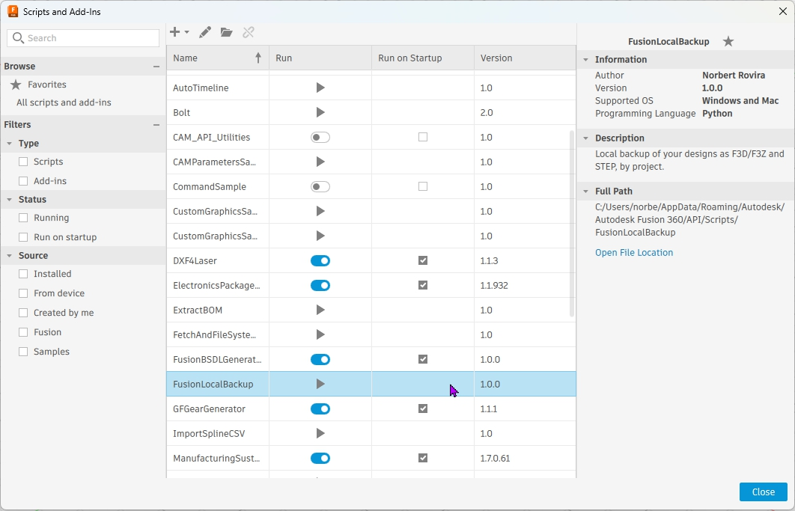
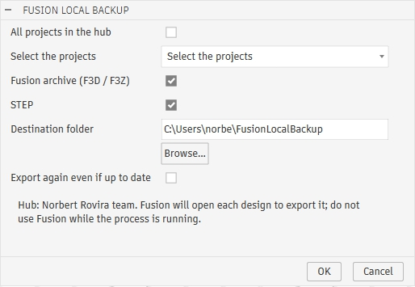
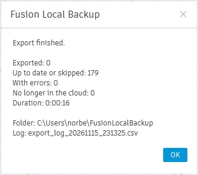

# Fusion Local Backup user guide

*[Leer en español](guia.md)*

This guide explains how to install the script, make your first backup and keep it current.

## Before you start

- You need Autodesk Fusion installed and signed in.
- The script has been tested on Windows. It has not been tested on Mac yet.
- The backup takes disk space: each design is saved in two formats (Fusion archive and STEP).
- The first backup of a large project takes a long time. Pick a moment when you do not need Fusion.

## Installation

On the repository page, click **Code > Download ZIP** and unzip the file. Inside you will find a folder called `FusionLocalBackup`, with `FusionLocalBackup.py` and `FusionLocalBackup.manifest`. That folder is the script.

There are two ways to install it. Pick the one you prefer.

### Option A: in Fusion's scripts folder

Fusion picks up whatever is in its scripts folder directly.

1. Copy the `FusionLocalBackup` folder into Fusion's scripts folder:
   - Windows: `%appdata%\Autodesk\Autodesk Fusion 360\API\Scripts`. You can paste that path as is into the File Explorer address bar.
   - Mac: `~/Library/Application Support/Autodesk/Autodesk Fusion 360/API/Scripts`. In Finder, use **Go > Go to Folder** and paste the path.
2. In Fusion, open **UTILITIES > Add-Ins > Scripts and Add-Ins** (shortcut: `Shift + S`). The script is already in the list; if not, restart Fusion.

### Option B: in any folder you like

1. Put the `FusionLocalBackup` folder somewhere permanent. Fusion does not copy it, it runs it from where it is, so if you move or delete it later the script will stop working.
2. In Fusion, open **UTILITIES > Add-Ins > Scripts and Add-Ins** (shortcut: `Shift + S`).
3. Click the **+** button, at the top left of the list, and choose the option to add from your device.
4. Select the `FusionLocalBackup` folder.

Either way, the script shows up in the list as **FusionLocalBackup**. You only need to install it once.



To update it later, download the new version and replace the files in the folder where you installed it.

## Your first backup

1. In the Scripts and Add-Ins window, find **FusionLocalBackup** and click the ▶ icon in the **Run** column.
2. The script's dialog opens, with these options:



| Option | What it is for |
|---|---|
| **All projects in the hub** | Backs up every project in the active hub. |
| **Select the projects** | A list of projects with checkboxes. Tick only the ones you want to back up. It is hidden when the previous option is ticked. |
| **Fusion archive (F3D / F3Z)** | Saves each design in Fusion's own format, which keeps the history and can be opened and edited again. |
| **STEP** | Also saves a STEP copy, a neutral format any CAD program can open. |
| **Destination folder** | Where the backup is saved. Use **Browse...** to pick it. |
| **Export again even if up to date** | Exports everything selected again, changed or not. Normally left unticked. |

3. Click **OK**.

A tip to begin with: try a small project first, to see how it works and how long it takes on your computer.

The dialog is shown in Spanish when Fusion runs in Spanish, and in English otherwise.

## What happens while it works

1. **Scan.** The script walks the chosen projects and shows how many files it has found.
2. **Export.** It opens each design, exports it and closes it. The bar shows which one it is on.
3. **Final wait.** If there are assemblies, at the end it waits for the last F3Z files to arrive.

Do not use Fusion in the meantime: you will see designs opening and closing on their own.

You can click **Cancel** at any time. The script finishes the design it has open and stops. What has been exported is recorded, so the next run carries on from there.

When it finishes, a summary appears:



## What you will find in the destination folder

The backup mirrors the structure you have in Fusion:

```
FusionLocalBackup/
├── fusion-local-backup.json
├── export_log_20261115_195916.csv
└── Hub name/
    └── Project name/
        ├── Part.f3d
        ├── Part.step
        └── Subfolder/
            ├── Assembly.f3z
            └── Assembly.step
```

- **The designs**, each in its folder, with the same name as in Fusion.
- **`fusion-local-backup.json`**: the index. It records which version of each design has been backed up. Do not delete or edit it: without it, the script does not know what you already have and exports everything again.
- **`export_log_DATE.csv`**: the log of each run. It opens in Excel or any spreadsheet.

### F3D or F3Z

- A design with no links to others is saved as **F3D**.
- A design that links other designs (an assembly with linked parts) is saved as **F3Z**, which contains the assembly and all its parts.

That is why, in a project with assemblies, each part appears twice: on its own as F3D and inside the assembly's F3Z. This is expected.

### The log

Each line of the CSV is a file, with one of these statuses:

| Status | Meaning |
|---|---|
| **ok** | Exported. The detail shows the formats and the version, for example `F3D, STEP (v7)`. |
| **skipped** | Not exported: it was already up to date, or it is not a 3D design (drawings, templates and the like). |
| **error** | It failed. The detail says which format and why. |
| **not in cloud** | The design had been backed up but no longer exists in Fusion. The local copy is kept. |

The last line shows the total duration.

If an assembly uses an older version of a linked part, the detail says so: `Uses outdated references: Part v3 -> v12`. The backup is correct; it only tells you that the assembly is waiting to be updated in Fusion.

## Keeping the backup current

Run the script again whenever you like, **with the same destination folder**. The dialog remembers the folder and the projects you ticked, so you just open it and click OK.

On each run, the script compares the version of each design in the cloud with the one it has recorded, and only exports:

- new designs,
- designs you have changed and saved since the last backup,
- designs missing from the disk.

The disk always holds the latest version of each design; earlier ones are replaced.

Also:

- If you **rename or move** a design in Fusion, its local files are moved to the new place.
- If you **delete** a design in Fusion, its local copy is not deleted; the log tells you.

## Frequently asked questions

**Why am I getting emails from Autodesk?**
Each F3Z is packed by Autodesk in the cloud, and their service sends an "is ready to be downloaded" email for each one. You do not need to do anything with them: the file is already in your folder. If you have many assemblies, set up a mail filter for those messages.

**Why does it take so long the first time?**
Because every design has to be opened once, and each takes several seconds. Later backups only open what has changed and are much quicker.

**Can I keep working in Fusion while it backs up?**
No. The script uses Fusion to open and export each design.

**Does it change my designs?**
No. It opens them, exports them and closes them without saving.

**Does it keep the version history?**
No. It keeps the latest version of each design.

**Does it back up drawings and electronics?**
Not yet. Only 3D designs. The rest is noted in the log as skipped.

**What if I choose a different destination folder?**
A new full backup is made in that folder, with its own index.

**I have several hubs. How do I back them up?**
The script works with the active hub. Switch hubs in Fusion's data panel and run it again.

**I changed a part, but the assembly's F3Z was not exported again.**
That is correct. The F3Z saves the assembly as it is saved, with the version of each part it is pinned to. It will be exported again once you open the assembly, accept the update and save it. The changed part is backed up on its own.

## If something goes wrong

- **A design gives an error.** Check the detail column of the log. The other designs are exported anyway, and the one that failed is retried on the next run.
- **An F3Z does not arrive.** If Autodesk does not deliver it within ten minutes, it is logged as an error and the script carries on. Run it again later.
- **Fusion seems stuck at the start.** In large projects the initial scan can take a while. The file counter tells you it is still working.
- **You want to start from scratch.** Tick "Export again even if up to date", or choose an empty destination folder.

If you find a problem, open an issue in the repository's **Issues** tab and include the log line that fails.
